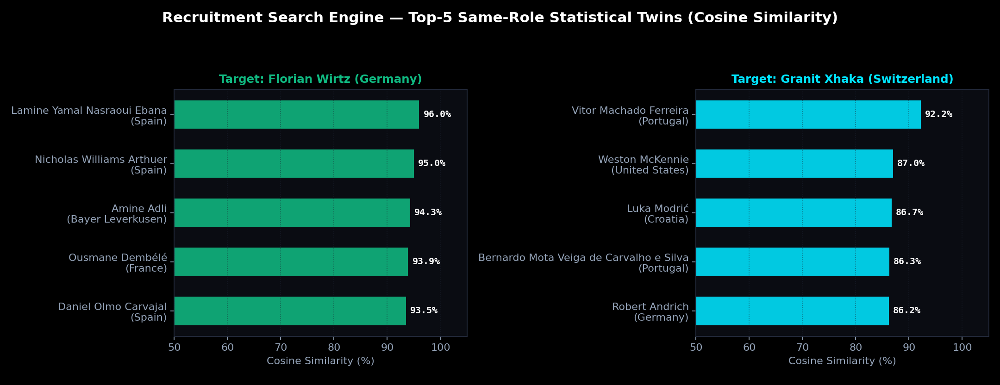
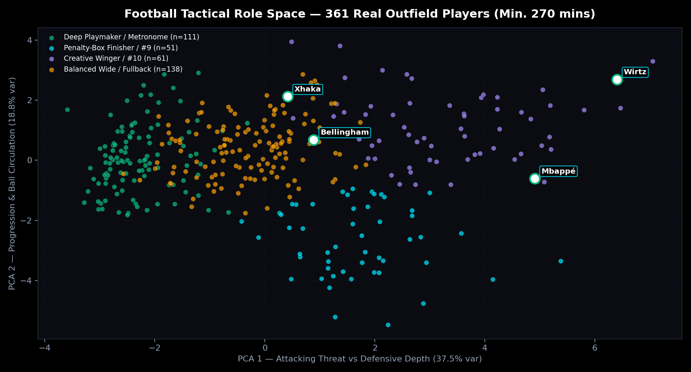
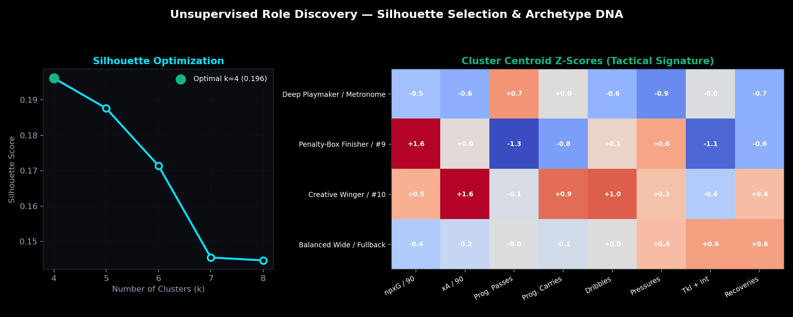
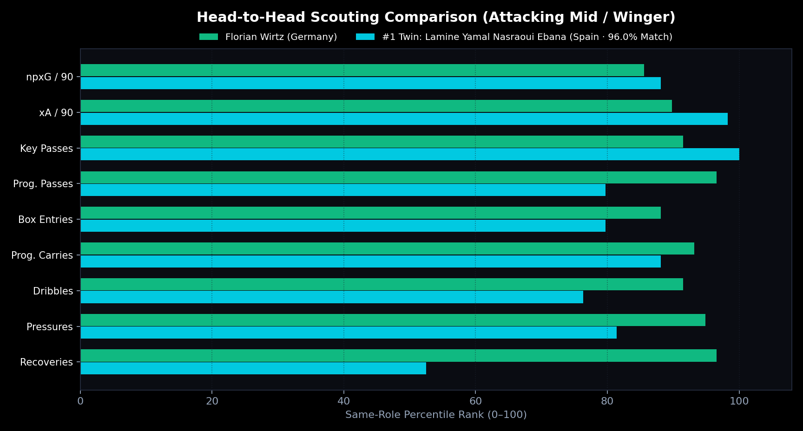

# Football Scouting & Tactical Player Similarity Engine

[](https://github.com/mostafasaad91/football-scouting-similarity-engine/actions/workflows/ci.yml)


> **End-to-End Football Recruitment Analytics & Unsupervised ML** — Official **StatsBomb Open Data** (**1,305 real players** across **149 matches**: FIFA World Cup 2022 + UEFA Euro 2024 + Bundesliga 2023/24) · SQLite Per-90 Scouting Mart · **Silhouette-Optimized K-Means Role Discovery** · **PCA Tactical Space** · **Role-Gated Cosine Similarity "Find a Replacement" Engine** · Same-Role Percentile Comparison Cards.



---

## Executive Summary & Verified Results

Built to solve a real club Sporting Director workflow: *"If we lose Florian Wirtz, Granit Xhaka, Kylian Mbappé, or Jude Bellingham, who are the closest tactical statistical twins in the same positional role?"*

| Metric | Value | Notes |
|---|---|---|
| **Raw Player Pool** | **1,305 real StatsBomb players** | Harvested from 149 matches (WC 2022 + Euro 2024 + Bundesliga 23/24) |
| **Data QA & Eligibility Gate** | **361 eligible outfield players** | **81 goalkeepers** excluded · **863 low-minute** (`< 270 mins`) players excluded |
| **Per-90 Feature Space** | **13 standardized tactical KPIs** | `npxG/90`, `xA/90`, `key passes`, `prog passes`, `prog carries`, `box entries`, `dribbles`, `pressures`, `tackles+int`, `recoveries`, `passes`, `pass %`, `shots` |
| **Unsupervised Role Discovery** | **Optimal `k = 4` tactical archetypes** | Selected programmatically by max **Silhouette Score = `0.1961`** (`k ∈ [4..8]`) |
| **PCA Tactical Map Variance** | **56.3% captured in 2D** | PC1 (`37.5%`): Attacking Threat vs Depth · PC2 (`18.8%`): Progression & Circulation |
| **Similarity Engine** | **Role-Gated Cosine Similarity** | Compares standardized 13D style vectors strictly within the same positional group |

---

## Discovered Tactical Archetypes (`k = 4` via Silhouette Optimization)

| Archetype | Players | Tactical Identity |
|---|---:|---|
| **Balanced Wide / Fullback** | 138 | Two-way width, balanced progression, recoveries & midfield link-up |
| **Deep Playmaker / Metronome** | 111 | High pass volume, high pass accuracy, defensive stability & deep build-up |
| **Creative Winger / #10** | 61 | Elite `xA/90`, key passes, progressive carries, dribbles & box entries |
| **Penalty-Box Finisher / #9** | 51 | High `npxG/90` & shot volume with lower deep-circulation volume |

---

## Verified Real-World "Find a Replacement" Shortlists

### 1. Replacing **Florian Wirtz** *(Attacking Mid / Winger · 2,734 mins)*
| Rank | Statistical Twin | Team | Match % | `npxG/90` | `xA/90` | Prog Passes/90 | Prog Carries/90 |
|---:|---|---|---:|---:|---:|---:|---:|
| **1** | **Lamine Yamal** | Spain | **96.0%** | 0.28 | 0.38 | 5.60 | 14.18 |
| **2** | **Nico Williams** | Spain | **95.0%** | 0.13 | 0.17 | 5.55 | 11.39 |
| **3** | **Amine Adli** | Bayer Leverkusen | **94.3%** | 0.29 | 0.23 | 4.93 | 9.10 |
| **4** | **Ousmane Dembélé** | France | **93.9%** | 0.09 | 0.25 | 5.10 | 15.28 |
| **5** | **Dani Olmo** | Spain | **93.5%** | 0.24 | 0.20 | 3.18 | 8.82 |

### 2. Replacing **Granit Xhaka** *(Central Midfielder · 3,774 mins)*
| Rank | Statistical Twin | Team | Match % | `npxG/90` | `xA/90` | Prog Passes/90 | Prog Carries/90 |
|---:|---|---|---:|---:|---:|---:|---:|
| **1** | **Vitinha** *(Vitor Machado Ferreira)* | Portugal | **92.2%** | 0.13 | 0.04 | 8.47 | 12.52 |
| **2** | **Weston McKennie** | United States | **87.0%** | 0.12 | 0.03 | 11.78 | 10.14 |
| **3** | **Luka Modrić** | Croatia | **86.7%** | 0.09 | 0.09 | 13.22 | 11.54 |
| **4** | **Bernardo Silva** | Portugal | **86.3%** | 0.10 | 0.10 | 5.68 | 13.14 |
| **5** | **Robert Andrich** | Germany | **86.2%** | 0.09 | 0.08 | 9.60 | 6.84 |

### 3. Replacing **Kylian Mbappé** *(Attacking Mid / Winger · 1,102 mins)*
- **#1 Neymar** (**97.2%**) · **#2 Jamal Musiala** (**92.3%**) · **#3 Vinícius Júnior** (**90.9%**) · **#4 Kenan Yildiz** (**90.4%**) · **#5 Rafael Leão** (**90.4%**)

### 4. Replacing **Jude Bellingham** *(Attacking Mid / Winger · 1,115 mins)*
- **#1 Jamal Musiala** (**84.7%**) · **#2 Lovro Majer** (**82.9%**) · **#3 Jae-Sung Lee** (**82.6%**) · **#4 Jeremy Doku** (**79.5%**) · **#5 Sofiane Boufal** (**78.2%**)

---

## Visual Outputs (AMOLED Edition)

| 2D PCA Tactical Role Space | Silhouette Curve & Archetype DNA |
|---|---|
|  |  |

| Top-5 Statistical Twin Shortlists | Head-to-Head Scouting Card (Wirtz vs Yamal) |
|---|---|
|  |  |

---

## Project Architecture

```text
football-scouting-similarity-engine/
├── data/raw/statsbomb_players_real.csv    # 1,305 real StatsBomb players aggregated from 149 matches
├── sql/01_scouting_views.sql              # SQLite per-90 scouting mart + GK/minutes filter + role grouping
├── src/run_pipeline.py                    # SQL -> Silhouette K-Means -> PCA -> Cosine Similarity -> 4 AMOLED plots
├── tests/test_pipeline.py                 # Automated QA, Silhouette, similarity & visual artifact tests
├── docs/PROJECT_STORY.md                  # Full Bilingual (EN + AR) Story: Why, How & Recruitment ML Challenges
├── outputs/
│   ├── metrics.json                       # Verified QA stats, silhouette curve, PCA variance & shortlists
│   ├── scouting_database.csv              # 361 eligible players with archetypes, PCA & same-role percentiles
│   ├── scouting_shortlists.json           # JSON API-ready replacement shortlists
│   └── figures/                           # 4 publication-grade AMOLED PNG figures
└── requirements.txt
```

## Quick Start

```bash
pip install -r requirements.txt
python src/run_pipeline.py
python tests/test_pipeline.py
```

Read the full engineering & recruitment analytics story (English + Egyptian Arabic) in [docs/PROJECT_STORY.md](docs/PROJECT_STORY.md).

---

**Author:** Mostafa Saad · Football Data Scientist & Tactical Analyst · [Portfolio](https://mostafasaad91.github.io/?track=football) · [Substack](https://mostafasaad.substack.com/) · [X](https://x.com/TacTical_41)
